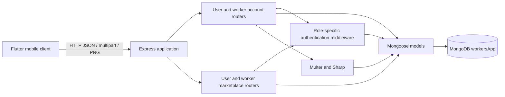
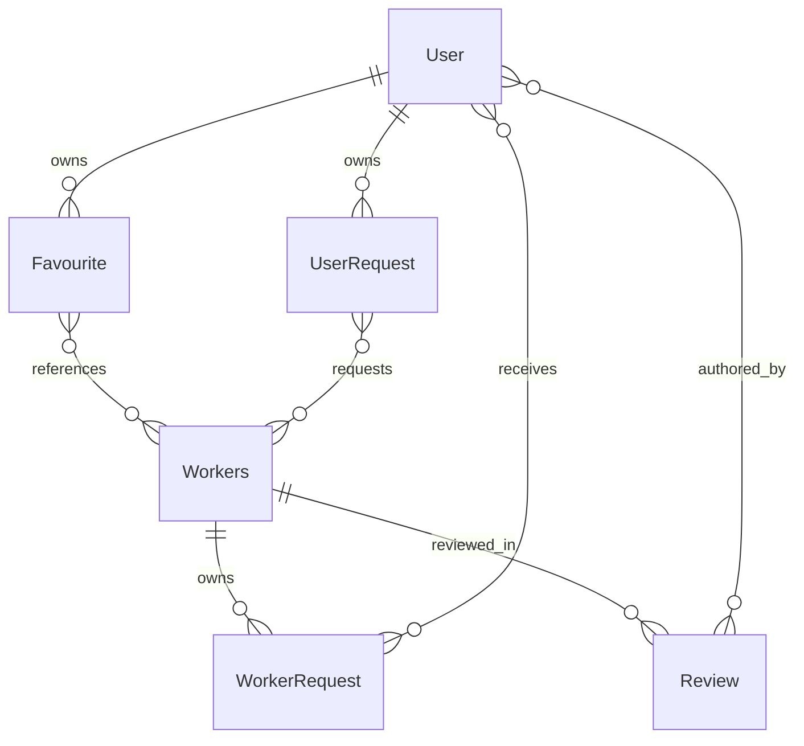
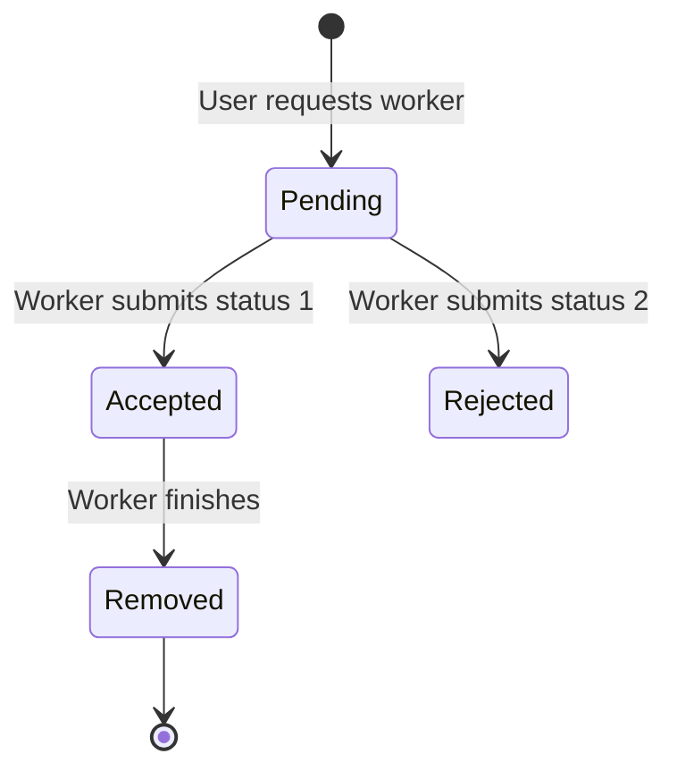

# Workers App — Complete Backend Code Study

**Analysis date:** October 12, 2026 (Asia/Kolkata).  
**Analyzed revision:** `ec3d17a3b0dd2f3bd485d8af8f281579c8febf09` (`main`).  
**Backend directory:** `workersapp-server/`.  
**Method:** complete static reading of all backend source files, package manifests, locally available Git history, and relevant Flutter API consumers. Runtime execution was unavailable because `node` is not installed or exposed on this workspace's command path. No database contents or remote hosting logs were supplied.

This document describes the code as it exists. Intended behavior, actual defects, and proposed improvements are distinguished explicitly. The requested “time range on Git” is interpreted as the range of available commit timestamps; those timestamps cannot establish the hours spent developing the application or the time it was uploaded to a hosting service.

## Contents

1. [Project purpose and scope](#1-project-purpose-and-scope)
2. [Git history and time range](#2-git-history-and-time-range)
3. [Source inventory and architecture](#3-source-inventory-and-architecture)
4. [Packages and configuration](#4-packages-and-configuration)
5. [Startup and HTTP request lifecycle](#5-startup-and-http-request-lifecycle)
6. [Complete database model study](#6-complete-database-model-study)
7. [Authentication and sessions](#7-authentication-and-sessions)
8. [Complete endpoint reference](#8-complete-endpoint-reference)
9. [Business workflows and state transitions](#9-business-workflows-and-state-transitions)
10. [Response contracts and examples](#10-response-contracts-and-examples)
11. [Flutter integration findings](#11-flutter-integration-findings)
12. [Defects and correctness analysis](#12-defects-and-correctness-analysis)
13. [Security and privacy analysis](#13-security-and-privacy-analysis)
14. [Performance and data integrity](#14-performance-and-data-integrity)
15. [Local setup and operational behavior](#15-local-setup-and-operational-behavior)
16. [Verification plan](#16-verification-plan)
17. [Prioritized improvement plan](#17-prioritized-improvement-plan)
18. [Study guide and glossary](#18-study-guide-and-glossary)
19. [Evidence and coverage](#19-evidence-and-coverage)

## 1. Project purpose and scope

The application connects customers, called **users** in the backend, with service providers, called **workers** in the backend and often **labour** in the Flutter client. Users browse available workers, search by name or specialization, save favorites, request services, inspect requests, and submit ratings. Workers inspect customer requests, accept or reject them, finish work, and read their reviews.

The backend is a small CommonJS Node.js application. Express receives HTTP requests; Mongoose defines documents and performs MongoDB operations; JWTs and stored token arrays handle sessions. Images are uploaded through Multer, converted by Sharp, and stored directly in account documents.

Implemented capabilities:

- Separate user and worker signup, login, profile, logout, and avatar routes.
- Worker discovery filtered by availability, with computed average ratings.
- Case-insensitive worker search using regular expressions.
- Favorite worker management.
- Mirrored request records for users and workers.
- Worker-controlled request status changes and request removal on completion.
- Ratings and comments grouped by worker.

There is no implemented payment system, scheduling system, job description, geographical matching, notification delivery, administrative interface, password reset, email verification, or audit trail. The commented location import and cron call do not implement those features.

## 2. Git history and time range

### 2.1 Available commits

The local history reachable through `git log --all` contains two commits. Author and committer timestamps are identical for each commit and already use India's UTC+05:30 offset.

| Sequence | Commit | Date and time, IST | Message | Meaning supported by the diff |
|---|---|---|---|---|
| 1 | `b54543801edaa827a5f0caa9654c2fcccd872c5f` | May 20, 2023, 15:26:20 | `my first try on full stck mobile app` | Initial snapshot containing backend source, Flutter source, and tracked backend dependencies. |
| 2 | `ec3d17a3b0dd2f3bd485d8af8f281579c8febf09` | May 20, 2023, 15:50:28 | `Your commit message` | Removes 4,029 files, all under `workersapp-server/node_modules/`. |

**Recorded commit window: 24 minutes and 8 seconds**, or 1,448 seconds, on May 20, 2023.

The second commit reports **540,486 deleted lines** across those dependency files. This large deletion is dependency cleanup; it is not deletion of the application's backend implementation.

### 2.2 Backend evolution

The comparison between the two commits shows no changes under `workersapp-server/src/`, `workersapp-server/package.json`, or `workersapp-server/package-lock.json`. The entire backend source analyzed here was present in the first commit and remains the same in the second.

Consequently, Git supports one source snapshot and one dependency cleanup event. It does not provide intermediate steps showing when individual features were written. The visible branch names are local `main`, remote tracking `origin/main`, and `origin/HEAD` pointing to `origin/main`.

### 2.3 What the timestamps do and do not establish

- They establish when the recorded commits were authored and committed according to their metadata.
- They establish the elapsed time between the available commits.
- They do not establish the actual total development duration: code may have been written before the first commit.
- They do not establish a GitHub push time, upload time, deployment date, or continuous work session.
- File modification timestamps from the 2026 local checkout are not substitutes for the original development dates.
- No remote fetch was performed; this analysis covers the history available in the supplied checkout.

### 2.4 Commands for reproducing the history analysis

```powershell
git log --all --reverse --format='%H | %aI | %cI | %s'
git log --oneline -- workersapp-server/src
git diff b545438 ec3d17a --stat -- workersapp-server/src workersapp-server/package.json workersapp-server/package-lock.json
git show ec3d17a --format=short --shortstat
git diff --name-only b545438 ec3d17a
git branch -a
```

The filtered diff is empty. The source-specific log contains only the initial commit.

## 3. Source inventory and architecture

### 3.1 Directory structure

```text
workersapp-server/
├── package.json
├── package-lock.json
└── src/
    ├── index.js
    ├── db/
    │   └── mongoose.js
    ├── middleware/
    │   └── auth.js
    ├── models/
    │   ├── user.js
    │   ├── workers.js
    │   ├── favourite.js
    │   ├── request.js
    │   └── review.js
    └── routes/
        ├── user.js
        ├── workers.js
        ├── forUser.js
        └── forWorker.js
```

### 3.2 File-by-file responsibility

Line counts include blank lines and comments as read from the supplied files.

| File | Lines | Responsibility |
|---|---:|---|
| [src/index.js](workersapp-server/src/index.js) | 21 | Application construction, JSON parsing, router registration, listener startup. |
| [src/db/mongoose.js](workersapp-server/src/db/mongoose.js) | 10 | Connection to local MongoDB and connection result logging. |
| [src/middleware/auth.js](workersapp-server/src/middleware/auth.js) | 42 | User and worker bearer-token validation. |
| [src/models/user.js](workersapp-server/src/models/user.js) | 118 | User fields, validation, token generation, login verification, password hashing, JSON serialization. |
| [src/models/workers.js](workersapp-server/src/models/workers.js) | 131 | Worker fields and equivalent account/session behavior. |
| [src/models/favourite.js](workersapp-server/src/models/favourite.js) | 17 | User-owned embedded favorite worker references. |
| [src/models/request.js](workersapp-server/src/models/request.js) | 58 | Both request schemas and worker availability. |
| [src/models/review.js](workersapp-server/src/models/review.js) | 31 | Embedded ratings/comments and review count. |
| [src/routes/user.js](workersapp-server/src/routes/user.js) | 105 | Six user account and image endpoints. |
| [src/routes/workers.js](workersapp-server/src/routes/workers.js) | 109 | Six worker account and image endpoints. |
| [src/routes/forUser.js](workersapp-server/src/routes/forUser.js) | 365 | Eleven user marketplace endpoints. |
| [src/routes/forWorker.js](workersapp-server/src/routes/forWorker.js) | 199 | Six worker workflow endpoints. |
| **Total source** | **1,206** | **12 JavaScript files; 29 declared routes; 6 Mongoose models.** |

### 3.3 Architectural shape



Routes combine transport handling, validation decisions, business rules, response mapping, and persistence. There are no separate controller, service, or repository layers. This keeps the first implementation short but makes repeated logic and multi-document workflows harder to maintain.

The four routers mount without a shared prefix. The public paths are therefore exactly the strings inside each router; there is no `/api` or `/v1` prefix.

## 4. Packages and configuration

### 4.1 Package identity

`package.json` names the backend `workerapp`, version `1.0.0`, with an ISC license. Description and author fields are empty.

Its `main` field is `index.js`, but the application file is `src/index.js`. The provided npm scripts use the correct path, so `npm start` works around that mismatch. Importing the directory as a package would use the incorrect entry point.

### 4.2 Direct dependencies

These versions come from the supplied package files, not from a current registry lookup.

| Package | Declared range | Locked version | Use in this project |
|---|---|---|---|
| `express` | `^4.18.2` | `4.18.2` | Application, routers, body parsing, HTTP responses. |
| `mongoose` | `^7.0.3` | `7.0.3` | MongoDB schemas, queries, population, hooks. |
| `bcrypt` | `^5.1.0` | `5.1.0` | Password hash creation and comparison. |
| `jsonwebtoken` | `^9.0.0` | `9.0.0` | Signing and verifying JWTs. |
| `multer` | `^1.4.5-lts.1` | `1.4.5-lts.1` | Multipart avatar upload processing. |
| `sharp` | `^0.32.0` | `0.32.0` | Image resize and PNG conversion. |
| `validator` | `^13.9.0` | `13.9.0` | Email validation. |
| `nodemon` | `^2.0.21` | `2.0.21` | Development process restart; dev dependency. |

The lockfile uses format version 3. Among direct dependencies, Sharp declares Node `>=14.15.0`, Mongoose declares `>=14.0.0`, and JWT declares `>=12`. These are historical package engine constraints, not a recommendation to deploy an old runtime or a guarantee that the complete dependency tree will install on every modern runtime.

### 4.3 Scripts

```json
{
  "start": "node src/index.js",
  "dev": "nodemon src/index.js"
}
```

There are no test, lint, build, migration, seed, or production deployment scripts.

### 4.4 Runtime configuration

| Setting | Current implementation | Consequence |
|---|---|---|
| HTTP port | `process.env.PORT || 9001` | Only this setting is environment configurable. |
| Startup message | Says port `3000` | Log does not reflect actual listener configuration. |
| MongoDB address | `mongodb://127.0.0.1:27017/workersApp` | Backend assumes MongoDB is local to its host. |
| JWT secrets | Two literal signing strings in source | Cannot rotate through configuration; do not treat these checked-in values as private. |
| Avatar limit | `1000000` bytes | Decimal 1 MB input limit. |
| Avatar output | 250 by 250 PNG | Stored as a Buffer on the account. |
| Salary | `800 + experience * 5` | Computed once at worker signup. |
| Flutter base URL | `http://192.168.33.42:9001` | Client assumes a specific LAN address. |

There is no `.env` loading code, environment schema, configurable database URL, application-level TLS setup, CORS middleware, or configured request logging. Adding a `.env` file alone would not cause this code to load it.

## 5. Startup and HTTP request lifecycle

### 5.1 Startup sequence

1. `src/index.js` loads Express.
2. Requiring `./db/mongoose` starts a MongoDB connection as a side effect.
3. Four router modules are loaded; their model imports register the schemas.
4. `express()` creates the application.
5. `express.json()` parses JSON request bodies.
6. Account routers mount first, then marketplace routers.
7. `app.listen()` starts the HTTP listener.

The server does not await a successful database connection before listening. A failed connection is logged, but the HTTP startup path still runs. Depending on query buffering and connection timing, routes can accept requests while the database is unavailable and later fail or time out.

### 5.2 Protected JSON request

```mermaid
sequenceDiagram
    participant C as Client
    participant E as Express
    participant A as Authentication
    participant M as MongoDB
    C->>E: Request with Authorization: Bearer token
    E->>A: Invoke route's role middleware
    A->>A: Verify JWT signature
    A->>M: Find account by _id and tokens.token
    M-->>A: Matching account or no match
    alt Account and token match
        A->>E: Attach account/token; next()
        E->>M: Run route-specific queries or writes
        M-->>E: Results
        E-->>C: Route-specific response
    else Verification or lookup fails
        A-->>C: 401 JSON error
    end
```

### 5.3 Error-handling structure

Many handlers catch their own errors, but coverage and status codes differ. There is no global custom error middleware. Some async handlers have no catch; others set a status without sending a response. The image routes have local four-argument error callbacks for middleware errors, but failures inside their async handler are not explicitly forwarded with `next(error)`.

For the Express 4 structure used here, rejected async promises require deliberate handling. Static inspection identifies uncovered failure paths; exact runtime consequences should be verified after installing the locked dependencies and choosing a runtime.

## 6. Complete database model study

### 6.1 Relationship diagram



The diagram uses one-to-many owner relationships because the database schemas do not enforce one companion document per owner. The route code generally assumes one favorite, request, or review container for each owner. References inside these containers are embedded array entries, not independent job documents.

### 6.2 User model

Source: [models/user.js](workersapp-server/src/models/user.js).

| Field | Type | Required | Rules and behavior |
|---|---|---|---|
| `name` | String | Yes | Trimmed. |
| `email` | String | Yes | Trimmed, lowercased, unique index declaration, `validator.isEmail`. |
| `password` | String | Yes | Trimmed; minimum 7 characters; case-insensitive ban on substring `password`; hashed before save. |
| `phoneNo` | Number | Yes | No explicit telephone format validation. |
| `street` | String | Yes | Trimmed. |
| `address` | String | Yes | Trimmed. |
| `avatar` | Buffer | No | Stores converted PNG bytes. |
| `tokens` | Array of subdocuments | No explicit requirement on array | Each entry has required String `token`. |

Mongoose supplies document identifiers and version metadata under its defaults. No schema timestamps are enabled for this model.

**Virtuals:** `request` references `UserRequest`, and `favourite` references `Favourite`, both by matching account `_id` with child `owner`. These declarations are not persisted arrays. The routes mostly query the child models directly rather than populating these virtuals.

**Serialization:** `toJSON()` removes `password` and `tokens`. It does not remove `avatar`, `_id`, or version metadata. Signup/login responses therefore differ from the explicit profile object.

**Methods:**

- `generateAuthToken()` signs an `_id` payload, appends the token, saves, and returns the token.
- `findByCredentials(email, password)` queries the account and compares the submitted password using bcrypt.
- The pre-save hook hashes changed passwords using cost factor `8`. Saving an unchanged password avoids rehashing it.

### 6.3 Workers model

Source: [models/workers.js](workersapp-server/src/models/workers.js). The registered model name is **`Workers`**, including the final `s`.

| Field | Type | Required | Rules and behavior |
|---|---|---|---|
| `name` | String | Yes | Trimmed. |
| `email` | String | Yes | Same validation and normalization as user email. |
| `password` | String | Yes | Same validation and hashing as user password. |
| `specialization` | String | Yes | Trimmed; no allowed-category enum. |
| `experience` | Number | Yes | No minimum, maximum, unit, or integer restriction. |
| `workerJobId` | String | Yes | No uniqueness or format rule. |
| `phoneNo` | Number | Yes | No format rule. |
| `salary` | Number | No | Signup assigns formula result. Currency and payment period are unspecified. |
| `joinedDate` | Date | Yes | Signup sets current server time. |
| `avatar` | Buffer | No | Converted PNG. |
| `tokens` | Array | No explicit requirement on array | Required String token inside each entry. |

The account virtuals are `request → WorkerRequest` and `review → Review`. JSON serialization removes password and tokens. Token generation, login comparison, and hashing mirror the user model but use the worker signing secret.

The email uniqueness declarations are per collection. Nothing prevents the same email from appearing once as a user and once as a worker. `workerJobId` is neither verified against an external system nor unique in this schema.

### 6.4 Favourite model

Source: [models/favourite.js](workersapp-server/src/models/favourite.js).

```text
Favourite
  owner: required ObjectId → User
  favouriteList[]
    fav: ObjectId → Workers
```

There are no timestamps, unique owner index, array size limit, or required validator on each `fav`. The misspelled import variable `Favouirte` in the route file still refers to this exported model and is not itself a runtime lookup defect.

### 6.5 UserRequest model

Source: [models/request.js](workersapp-server/src/models/request.js).

```text
UserRequest
  owner: required ObjectId → User
  workerRequest[]
    requests: ObjectId → Workers
    status: Number, default 0
  createdAt: container creation time
  updatedAt: container update time
```

The exported variable is `UsersRequest`, but the registered model name is `UserRequest`. The timestamps belong to the whole container, not to each individual request. There is no unique job identifier connecting a user-side entry to its worker-side mirror.

### 6.6 WorkerRequest model

```text
WorkerRequest
  owner: required ObjectId → Workers
  userRequest[]
    requests: ObjectId → User
    status: Number, default 0
  workStatus: required Boolean, default true
  createdAt: container creation time
  updatedAt: container update time
```

The exported variable is `WorkersRequest`; the registered model name is `WorkerRequest`.

`workStatus` is an availability flag: **true means available** and **false means busy** in the discovery and accept flows. It is not the same as a request's numeric `status`.

Neither request status field has an enum or permitted range. References are not declared required inside the arrays. Neither owner field has a unique index.

### 6.7 Review model

Source: [models/review.js](workersapp-server/src/models/review.js).

| Field | Type | Rules |
|---|---|---|
| `reviews[].rating` | Number | Required, schema minimum 1, maximum 5. |
| `reviews[].comment` | String | Optional, trimmed. |
| `reviews[].user` | ObjectId | Ref `User`; optional in schema. |
| `noOfRated` | Number | No default or required constraint; incremented during submission. |
| `owner` | ObjectId | Ref **`Worker`**, which differs from registered **`Workers`** model. |

No timestamps are enabled on the container or review entries. Reading `review.createdAt` therefore does not obtain a timestamp created by this schema.

The wrong owner reference does not break the existing direct `findOne({ owner: workerId })` queries, because those queries do not populate `owner`. It would matter if owner population were added.

The rating route uses `findOneAndUpdate` without `runValidators: true`. The presence of schema min/max rules alone does not establish that the current update path enforces them.

## 7. Authentication and sessions

### 7.1 Signup and login

User signup first saves a new user, then generates and saves a token. Worker signup computes salary and joined date, then calls token generation; the save inside that method also persists the new worker and runs password hashing.

Both login flows call the appropriate model's credential lookup and generate another stored token. Login success returns `201`, even though it does not create a new account.

### 7.2 Role-specific middleware

Source: [middleware/auth.js](workersapp-server/src/middleware/auth.js).

Both middleware functions:

1. Read the `Authorization` header.
2. Remove the literal substring `Bearer `.
3. Verify the JWT with the role-specific secret.
4. Find an account whose `_id` matches the payload and whose `tokens.token` contains that exact token.
5. Attach `req.token` plus `req.user` or `req.worker`.
6. Call `next()`.

All failures are converted to:

```json
{"error":"Please authenticate."}
```

with HTTP `401`. A missing header throws during `.replace()` and is caught. Database lookup failures are also reported as authentication failures, which obscures the difference between invalid credentials and infrastructure failure.

### 7.3 Session properties

- JWT payloads contain the account ID, with no explicit role claim or expiry option.
- Role separation uses different signatures and different account collections.
- Authentication requires both signature validity and token membership in the account document.
- Logout filters out the current token and saves the account.
- Other stored sessions remain valid; there is no logout-all endpoint.
- No refresh token or session expiry cleanup is implemented.
- Signing the same payload within the same timestamp interval may produce the same JWT; each login should not be assumed to produce a globally unique token.
- The token array can grow without a configured bound.

### 7.4 Serialization boundary

The account `toJSON` overrides help prevent normal document responses from exposing password hashes or token arrays. They do not replace an input allowlist: signup accepts the entire request body, including recognized internal schema fields such as `tokens` and `avatar`.

## 8. Complete endpoint reference

All paths are relative to `http://<backend-host>:9001` unless `PORT` is set. `U` means user bearer authentication, `W` means worker bearer authentication, and `Public` means no authentication middleware. Unless noted otherwise, JSON is used for structured bodies and results.

The table lists ordinary success and route-specific failure paths. Every protected endpoint may also return the middleware's `401`. Database errors, invalid IDs, or uncovered async failures may produce additional outcomes described below.

### 8.1 User account routes — `routes/user.js`

| Method/path | Auth | Input | Success | Failure behavior |
|---|---|---|---|---|
| `POST /users-signup` | Public | User account fields | `201 { user, token }` | `500` with raw caught error, including validation/duplicate errors. |
| `POST /users-login` | Public | `email`, `password` | `201 { user, token }` | `400` with raw error. |
| `GET /users/profile` | U | None | `200 { id, name, email, phoneN, street, address }` | Authentication middleware handles auth failures. |
| `POST /users/logout` | U | None | `201`, empty body | Catch sets `400` but never sends or ends the response. |
| `POST /users/avatar` | U | Multipart field `avatar` | `200`, empty body | Upload middleware error callback sends `400 { error }`; async processing errors have no explicit catch. |
| `GET /users/avatar` | U | None | `200`, `image/png` bytes | `404`, empty body for missing image or caught lookup error. |

### 8.2 Worker account routes — `routes/workers.js`

| Method/path | Auth | Input | Success | Failure behavior |
|---|---|---|---|---|
| `POST /workers-signup` | Public | Worker account fields | `201 { worker, token }` | No try/catch around async save/token generation. |
| `POST /workers-login` | Public | `email`, `password` | `201 { worker, token }` | `404` with raw error. |
| `GET /workers/profile` | W | None | `200 { id, name, email, phoneN, specialization, experience, workerJobId, salary }` | Catch calls `res.send(404)` rather than an explicit `res.status(404)` response. |
| `POST /workers/logout` | W | None | `200`, empty body | Catch sets `400` but does not send/end. |
| `POST /workers/avatar` | W | Multipart field `avatar` | `200`, empty body | Same upload and async error limitations as user avatar. |
| `GET /workers/avatar` | W | None | `200`, `image/png` bytes | `404`, empty body on missing avatar or caught lookup failure. |

### 8.3 User marketplace routes — `routes/forUser.js`

| Method/path | Auth | Input | Success | Important failure/contract details |
|---|---|---|---|---|
| `GET /users/home` | U | None | `200`, available worker cards | `500 "Server error"`; includes review author names/emails. |
| `GET /search` | U | Query `q` | `200`, available matching worker cards | `500 "Server error"`; query used as regex. |
| `POST /user-fav/:id` | U | Worker ID in path | `201`, empty body | `404 { message: "Worker not found" }`; duplicate `400`; catch `500` text. |
| `GET /user-fav` | U | None | `200`, favorite worker cards | `404 { message: "User Not Found" }` if container absent; no outer async catch. |
| `DELETE /user-fav/:id` | U | Worker ID | `201 { message: "Worker removed from favourites" }` | Missing container `404`; catch `500` raw error; absent entry in existing container still succeeds. |
| `POST /user-request/:id` | U | Worker ID | `201`, empty body | Missing worker/blocked repeat `404`; catch `400 { error }`; availability check is defective. |
| `GET /users/history` | U | None | `200`, flattened worker/request list | Empty history `404 { message: "No history found" }`; catch `400 { error }`. |
| `GET /users/fetch-status` | U | **GET JSON body** `status` | `200`, worker documents | Compares stored status string to supplied value exactly; no results `404 { error: "Request not found" }`; catch `400`. |
| `POST /users/review/:id` | U | Worker ID; `rating`, optional `comment` | `201`, empty body | Missing user request container `404 { message: "Error" }`; catch `500 { message: "Server error" }`; eligibility condition is defective. |
| `GET /users/isfav/:id` | U | Worker ID | `200` if **not favorited** | `404` if favorited; `500` on caught error; success/found bodies are status text. |
| `GET /users/ishistory/:id` | U | Worker ID | `200`, empty body if no pending match | `404`, empty body if pending status `0` exists; catch `500 "Server Error"`. |

### 8.4 Worker marketplace routes — `routes/forWorker.js`

| Method/path | Auth | Input | Success | Important failure/contract details |
|---|---|---|---|---|
| `GET /workers/history` | W | None | `200 [{ user, status }]` | Empty history `404 { error: "Empty Array" }`; catch `400 { error }`. |
| `POST /workers/change-status` | W | JSON `id` = user ID, `status` | `200`, empty body | Catch `404` raw error; no response when container/entries absent; no state enum. |
| `GET /workers/fetch-status` | W | None | `200 [{ user, status }]`, status `1` only | Empty accepted list is `200 []`; catch `400 { error }`. |
| `POST /workers/finish` | W | JSON `id` = user ID | `201 { message: "Request done successfully" }` | Missing entry `404 { error: "Request not found" }`; missing container or other exception `400 { error: message }`. |
| `GET /worker/status-updates/:id` | W | User ID | `200 { status: number }` | Missing container or entry `404 { error }`; catch `400 { error: message }`. |
| `GET /workers/review` | W | None | `200`, formatted reviews | Absent review container calls undefined `status(404)`; no async catch. |

The singular `/worker/status-updates` and plural `/workers/...` prefixes coexist. The API does not normalize them.

### 8.5 Detailed discovery algorithm

Home performs these operations:

1. Read every worker using `Workers.find({})`.
2. For each worker, find its request container.
3. Include the worker if no container exists or `workStatus == true`.
4. For included workers, query the review container and populate reviewer accounts.
5. Map ratings/comments and reviewer name/email.
6. Sum ratings and divide by the number of reviews; use `0` for no reviews.
7. Return an explicitly constructed worker card.

Search duplicates this mapping but changes the initial query to a case-insensitive `$or` regex match on `name` and `specialization`. There is no pagination, sorting, query length limit, regex escaping, or explicit missing-`q` validation.

The populated user projection includes fields such as specialization and salary that do not belong to the User schema. Only reviewer name/email are used in the output. If a referenced user is missing, `review.user.name` can throw and fail the whole discovery response.

### 8.6 Detailed favorite operations

Add favorite first verifies the worker exists. It then checks the current list in application code, returns a duplicate error if found, and upserts with `$addToSet`.

Read favorites resolves each worker ID with `Promise.all`. It returns identity, specialization, image, salary, and experience, without the availability filter or rating enrichment used by discovery. One unresolved/deleted worker rejects the whole operation rather than skipping that entry.

Remove favorite uses `$pull`. It distinguishes a missing favorite container from an existing container but does not distinguish an absent entry from a removed entry. The membership endpoint deliberately uses `404` for a found favorite and `200` for an absent favorite.

## 9. Business workflows and state transitions

### 9.1 Status interpretation

| Value | Meaning supported by code/client | Enforcement |
|---:|---|---|
| `0` | Pending; schema default and pending-history check. | Default exists; transitions are not enforced. |
| `1` | Accepted; worker accepted list filters this value; acceptance sets busy. | Worker change route accepts it. |
| `2` | Rejected; client rejection path uses 2. | Also blocks another request from the same user in current backend logic. |
| `3` | Treated by some user UI/review logic as eligible or approved. | No dedicated backend completion transition writes 3. Its precise business meaning is not established. |

Do not describe status `3` as a persisted completed state: finishing a request removes both entries instead.

### 9.2 Intended request lifecycle



This diagram expresses the UI's apparent normal workflow. The server does not enforce this state machine: arbitrary numeric values, changes from already accepted/rejected states, and finishing nonaccepted requests are not explicitly forbidden.

### 9.3 Creating a request

Source: `forUser.js:186–219`.

1. Find the target worker; return 404 if absent.
2. Fetch worker request containers with `find()`.
3. Attempt to inspect `workers.workStatus`.
4. Inspect the user's existing worker entries.
5. Block the same worker if any matching entry has status `0` or `2`.
6. Upsert the worker container, adding a user reference and assigning `workStatus: true`.
7. Upsert the user container, adding a worker reference.
8. Return 201.

There are three major correctness concerns: `find()` returns an array, so its direct `workStatus` property does not inspect the container; creating a request explicitly resets availability to true; and the repeat guard blocks rejected requests but does not block accepted requests.

Both writes are sequential with no transaction. If the first succeeds and the second fails, the worker sees a request that the user cannot see in its mirrored data.

### 9.4 Changing status

Source: `forWorker.js:42–78`.

The route selects the first worker request container, finds an entry matching the supplied user ID, and returns immediately if the submitted status exactly equals that entry's current status. Otherwise it changes **all matching entries** for that user on the worker side and all matching entries for the worker on the user side.

Submitting numeric `1` marks the worker busy. Every other submitted status marks the worker available, even if another request remains accepted. The route then saves the worker container followed by the user container.

It does not validate that the submitted status is an allowed number, that the request was pending, that the worker has no other accepted work, or that both companion containers exist. Missing matching entries may throw during destructuring. Missing/empty worker containers can leave the HTTP response unfinished.

### 9.5 Finishing work

Source: `forWorker.js:107–141`.

`req.body.id` identifies a **user**, despite the local variable being called `requestId`. The route finds both containers, finds the first matching entry in each, removes them with `splice`, sets `workStatus` to true, and saves both documents.

Effects:

- Finished requests disappear from both history endpoints.
- No completion date, final state, cost, or review entitlement is recorded.
- There is no explicit requirement that the request be accepted.
- If duplicate entries exist, only the first match is removed.
- Availability is set true without checking for remaining accepted work.
- Partial save failure can leave the two sides inconsistent.

### 9.6 Review submission

Source: `forUser.js:283–318`.

The route requires a user request container, filters entries by worker ID, attempts an approval check, pushes a rating/comment/user subdocument, increments `noOfRated`, and upserts the worker's review container.

The approval check is logically broken. For any existing request entry, the expression `status !== 1 || status !== 3` is always true; a single value cannot equal both 1 and 3. The surrounding negation makes the rejection branch unreachable for such an entry. Pending and rejected requests therefore pass this check.

If the user has a container but no matching entry, `worker[0]` is undefined and property access throws, producing the route's generic 500. Review submission neither checks the worker exists separately nor prevents repeated reviews. After normal completion removes the request entry, the intended review entitlement cannot be recovered from history.

## 10. Response contracts and examples

These are illustrative payloads inferred from mappings and schemas, not captured live responses. IDs use valid-shaped placeholders; image bytes are abbreviated. Optional values may be omitted from JSON when their JavaScript value is undefined.

### 10.1 Signup inputs

User:

```json
{
  "name": "Sample Customer",
  "email": "customer@example.com",
  "password": "Example!842",
  "phoneNo": 9000000000,
  "street": "Example Street",
  "address": "Example City"
}
```

Worker:

```json
{
  "name": "Sample Worker",
  "email": "worker@example.com",
  "password": "Example!842",
  "phoneNo": 9000000001,
  "specialization": "Electrician",
  "experience": 4,
  "workerJobId": "WORKER-001"
}
```

The worker route sets `salary` to `820` and `joinedDate` to server time in this example. The code does not specify whether experience is years or whether salary is daily, hourly, or in a particular currency.

### 10.2 Discovery worker card

```json
{
  "id": "507f1f77bcf86cd799439011",
  "name": "Sample Worker",
  "email": "worker@example.com",
  "specialization": "Electrician",
  "phoneNo": 9000000001,
  "salary": 820,
  "experience": 4,
  "reviews": [
    {
      "rating": 5,
      "comment": "Completed the repair",
      "name": "Sample Customer",
      "email": "customer@example.com"
    }
  ],
  "avgRating": 5,
  "avatar": { "type": "Buffer", "data": [137, 80, 78, 71] }
}
```

The inline avatar object represents Buffer JSON serialization. It is not a base64 string and is not the complete PNG in this abbreviated example. The avatar endpoint returns actual binary PNG bytes instead.

### 10.3 Account response variants

| Response | Identifier | Telephone key | Image |
|---|---|---|---|
| Signup/login account document | `_id` | `phoneNo` | May include Buffer JSON. |
| User/worker explicit profile | `id` | **`phoneN`** | Excluded. |
| Home/search card | `id` | `phoneNo` | Optional Buffer JSON. |
| Favorite card | `id` | Excluded | Optional Buffer JSON. |
| User history item | `_id` | Excluded | Optional Buffer JSON. |
| Worker history nested user | `_id` | `phoneNo` | Optional Buffer JSON. |

These differences are part of the current wire contract. Consumers cannot assume one account/worker shape everywhere.

### 10.4 User history

```json
[
  {
    "_id": "507f1f77bcf86cd799439011",
    "name": "Sample Worker",
    "email": "worker@example.com",
    "specialization": "Electrician",
    "status": 0
  }
]
```

Although the route constructs `salary` and `experience` properties, its population projection excludes salary and experience. These values are normally undefined and omitted. It also assigns `experience` from the salary property, an independent mapping error.

### 10.5 Worker status operations

```json
{"id":"507f1f77bcf86cd799439012","status":1}
```

is an acceptance input, where the ID is the customer. Completion accepts:

```json
{"id":"507f1f77bcf86cd799439012"}
```

Polling that same customer ID returns:

```json
{"status":1}
```

### 10.6 GET status filtering inconsistency

`GET /users/fetch-status` reads `req.body.status`, then uses `storedStatus.toString() === status`. A JSON body of `{"status":"1"}` can match accepted entries; `{"status":1}` does not match because the supplied value is numeric. Supplying a query parameter does not work with the current handler because it does not read `req.query.status`.

### 10.7 Error response inconsistencies

The application uses `{ error: ... }`, `{ message: ... }`, raw Error objects, plain text, status text, and empty bodies. Native Error message properties are not generally enumerable, so serializing a raw error may produce `{}` rather than its message. Validation errors can serialize differently.

There is no stable machine-readable error code or consistent distinction among validation errors, missing entities, authorization failures, and server errors.

## 11. Flutter integration findings

The frontend was inspected to establish the backend's actual consumers, not to perform a complete UI review.

| Concern | Backend behavior | Flutter evidence | Consequence |
|---|---|---|---|
| Worker logout | Sends default `200`. | `laour_controller.dart` checks for `201`. | Backend can revoke the token while UI fails to take its success path. |
| Worker accept/reject | Sends `200`. | `acceptOrReject()` checks for `201`. | Successful status updates may show an error. |
| Worker history images | Populated user avatar is a Buffer JSON object if present. | `labour_request_model.dart` calls `base64Decode(json['avatar'])`. | Parsing expects the wrong type and also requires an image when the schema does not. |
| Numeric salaries/experience | Mongoose Number has no integer-only rule. | `workers_model.dart` declares `int salary` and `int experience`. | Fractional valid backend values can fail client typing. |
| User history numbers | Route omits the fields today; schema supports general numbers. | `user_history.dart` uses `as double?`. | Integer JSON values may fail if the backend mapping is corrected without updating parsing. |
| Review rating | Backend allows a Number, including fractional ratings if validated within bounds. | `labour_review_model.dart` requires `int rating`. | Fractional values can fail review parsing. |
| Review comment | Optional in schema. | Labour review model requires non-null String comment. | Missing comments can fail parsing. |
| Base URL | Backend defaults to 9001. | `global_variables.dart` hardcodes `192.168.33.42:9001`. | Client works only when server is reachable at that address. |
| Membership conventions | Found favorites/pending requests use 404. | Favorite/request controllers treat status codes as flags. | Changing these routes requires coordinated client changes. |

The worker signup client sends experience and phone number as strings taken from text controllers. Mongoose can cast valid numeric strings to Number; the salary multiplication also coerces experience to a number. Malformed strings need explicit validation rather than dependence on coercion and save errors.

Both authentication controllers store a token in SharedPreferences and attach it as a bearer token in later requests. The backend has no cookie-based session requirement.

The detailed worker screen also casts the `Future<void>` returned by `acceptOrReject()` to `Future<int>` and modifies its displayed state before confirmation. This is a client defect that can compound the backend/status-code mismatch.

## 12. Defects and correctness analysis

The findings below are based on source inspection. Severity reflects functional impact in the implemented workflows, not a claim that an exploit or live outage was observed.

### 12.1 High-impact defects

| ID | Location | Finding | Impact | Suggested correction |
|---|---|---|---|---|
| B01 | `forUser.js:193–195` | Availability read uses `.find()` array as a document. | Busy check does not inspect stored availability. | Use a single-document lookup and explicitly handle absence. |
| B02 | `forUser.js:205–208` | New request writes `workStatus: true`. | A busy worker may become discoverable without completing accepted work. | Do not reset availability when adding pending requests. |
| B03 | `forUser.js:199` | Duplicate guard blocks status 2 and 0, but permits status 1. | Rejected requests cannot be retried; accepted work can get another request. | Define allowed repeats and enforce them with a stable job identity. |
| B04 | `forUser.js:295` | Review authorization expression is always false for an existing entry after outer negation. | Pending/rejected entries can submit reviews. | Explicitly test an allowed-state set after verifying an entry exists. |
| B05 | `forUser.js:300–312` | Rating update has no update validators or request validation. | Schema rating bounds do not establish route-level enforcement. | Validate input and enable update validators. |
| B06 | `forWorker.js:183` | Calls undefined `status(404)`. | First-time worker with no reviews follows an uncovered exception path. | Return a proper `res.status(...)` response or `200 []`. |
| B07 | Request creation, status update, finish | Mirrored writes lack transactions. | One side can update while the other fails. | Use transactions or one canonical job document. |
| B08 | `forWorker.js:129–136` | Completion deletes request entries. | Completed history and durable review eligibility are lost. | Store terminal state and completion time. |
| B09 | `forWorker.js:58–62`, `132` | Availability overwritten without considering other accepted entries. | Worker can be shown available while accepted work remains. | Derive availability from active jobs or enforce single active job atomically. |
| B10 | `workers.js:10`, avatar handlers, favorite/review reads | Some async handlers have no catch/forwarding. | Validation, missing files, stale references, and database failures can leave uncontrolled failures. | Add consistent async error forwarding and terminal responses. |

### 12.2 Response and mapping defects

- **Unfinished logout error responses:** both logout catches only call `res.status(400)`; they do not send or end.
- **Unfinished status-change branch:** when the worker request document is absent or its array empty, the handler reaches the end without responding.
- **History projection mismatch:** user history reads salary/experience without selecting them.
- **History field typo:** user history sets experience from salary.
- **Review date mismatch:** worker review mapping asks for `createdAt` on entries whose schema has no timestamps.
- **Reference-name mismatch:** review owner uses `Worker`, but the defined account model is `Workers`.
- **Empty-find checks:** `if (!requests)` is ineffective for `find()` results because an empty array is truthy; later length checks handle some cases.
- **Profile exception code:** `res.send(404)` relies on the numeric-send behavior of the framework rather than an explicit status response.
- **Status filter body/type mismatch:** GET body plus string-only comparison is easy for callers to misuse.
- **Client success-code mismatch:** worker logout and status changes send 200 while Flutter expects 201.
- **Misleading startup log:** says 3000 although default listener is 9001.

### 12.3 Missing defensive checks

- Status-change destructures the result of `.find()` without checking whether an entry exists.
- Status-change assumes the mirrored user request container exists.
- Completion accesses both containers' arrays before checking whether the containers exist.
- Review eligibility assumes `worker[0]` exists.
- Discovery and worker review mapping assume populated reviewer accounts exist.
- Favorite reads reject the entire list if one referenced worker is missing.
- Image routes assume `req.file` exists and contains a decodable image.
- Request/status inputs have no dedicated object-ID or type validation.

### 12.4 Example failure traces

**Busy worker:** worker accepts customer A, so `workStatus` becomes false. Customer B directly calls request creation. The array-based busy check does not find false; the worker-side upsert sets true. Home/search can now include the worker while A's accepted entry remains.

**Pending review:** customer has a request entry with status 0. The condition `0 !== 1 || 0 !== 3` is true. The final negation is false, so the rejection response is skipped. The review is appended.

**No reviews:** worker calls `/workers/review` before any review container exists. The branch tries to invoke a variable/function named `status` that was not declared. The handler does not catch the resulting rejection.

**Successful update shown as failure:** worker changes a request to 1. Both saves succeed and server responds 200. Flutter tests for 201 and enters its error path even though the database changed.

## 13. Security and privacy analysis

### 13.1 Controls already present

- Passwords are hashed on save and compared using bcrypt.
- Protected routes use role-specific middleware.
- Stored token membership allows session revocation.
- Account document JSON removes password and tokens.
- Uploads have a byte-size limit and are re-encoded as PNG.
- Favorite/request writes generally derive the owner from the authenticated account rather than taking the user owner from a public parameter.

### 13.2 Authentication weaknesses

The JWT signing values are hardcoded in the repository. Move them into configuration and rotate them before treating the application as a deployed service. Because authentication also checks stored token membership, a forged signature alone is not enough to authenticate as an arbitrary account under this implementation; that extra check does not make exposed signing material acceptable.

There is no configured expiry, session cap, account lockout, login rate limit, or password recovery process. These are missing controls, not evidence that an attack occurred.

### 13.3 Signup input control

Both signup routes construct model instances from `req.body` directly. Recognized schema fields such as `tokens` and `avatar` can therefore be supplied by a caller even though they should be managed by the backend. Worker salary/joinedDate are overwritten by the route, but other internal fields are not allowlisted away.

Use explicit public registration fields rather than treating the database schema as the API input schema.

### 13.4 Review authorization

Review permission must be checked on the server. The current boolean defect and deleted completion records mean UI button visibility cannot establish review entitlement. A durable completed job and reviewer identity provide a better basis for one review per eligible job.

### 13.5 Input and upload handling

- Search uses caller-provided regex patterns. Unescaped patterns can change match semantics and increase query cost; exact resource impact depends on database contents and the chosen pattern.
- Upload filtering uses a case-sensitive filename extension check. Uppercase `.PNG` is rejected; a valid-looking filename alone does not prove valid image content.
- Sharp conversion can fail on unsupported/corrupt content and needs a handled response.
- The input byte limit does not by itself validate image dimensions or establish a decoded-pixel limit chosen by the application.
- Numeric phone fields do not preserve leading zeros or a leading `+` country code. Store telephone identifiers as validated strings.

### 13.6 Personal data exposure

Discovery exposes worker email and telephone number to every authenticated user. Review cards expose reviewer email. Worker request history exposes customer email, telephone, street, address, and avatar. These disclosures may support the marketplace workflow, but they should be deliberate, limited by purpose, and documented.

There is no data deletion API, retention policy implementation, or cleanup process for old embedded references. The checked-in client URL uses HTTP, and the backend has no TLS setup; any production transport protection would have to be provided externally and is not evidenced in this repository.

### 13.7 Dependency assessment boundary

Locked package versions are documented in section 4. No current vulnerability advisory lookup or dependency audit was run. This study does not assign current CVEs or claim the dependency tree is secure. A separate dependency review should use the lockfile and the actual deployment environment.

## 14. Performance and data integrity

### 14.1 Discovery query cost

For `N` workers and `A` available workers, home/search use roughly:

```text
1 initial worker query
+ N availability queries
+ A review-container queries
+ additional population reads for reviewer accounts
```

The loop awaits each worker's database operations before moving to the next worker. This produces both an N+1 query pattern and cumulative latency. Exact population query counts depend on Mongoose's grouping and the referenced records.

Fetching full worker documents also loads fields that are not needed for cards, including password hashes and stored tokens, before the route discards them. Use projections at query time.

### 14.2 Image transport cost

Avatar reads return compact binary PNG, but list responses embed arrays of byte values. JSON byte arrays increase response size compared with binary delivery and repeat the image for every returned card. Dedicated image URLs or object storage would simplify client parsing and caching.

### 14.3 Unbounded arrays

Tokens, favorite entries, request entries, and reviews have no application-level length limits. Review containers accumulate every comment for a worker and discovery returns all of them. Growth increases document size, response size, and the work required for updates and mapping. MongoDB document-size constraints eventually matter for this design; the project contains no handling for reaching them.

### 14.4 Owner uniqueness and races

The route code expects one container per owner, but the schema does not enforce that expectation. Concurrent upserts can create duplicates without a unique owner index. Subsequent `findOne` and `[first]` operations can read a different container from the one another request modified.

Before adding unique owner indexes to existing data, identify and reconcile duplicate containers. An index migration should not assume the data already satisfies uniqueness.

### 14.5 `$addToSet` limitations

The code adds embedded objects rather than only primitive reference IDs. Mongoose subdocuments can include generated `_id` values and default status values. `$addToSet` compares complete stored values, so it should not be treated as a guaranteed uniqueness rule for a particular worker/user reference alone. The preceding application-side duplicate checks are also subject to concurrent requests.

### 14.6 Mirrored records

Each request exists in two arrays. Creation writes worker then user; status change saves worker then user; finish saves worker then user. No shared request ID, transaction, reconciliation process, or immutable event log connects them.

A proposed alternative is one `Job` document:

```text
Job (proposed, not implemented)
  user: required account reference
  worker: required account reference
  status: constrained state
  requestedAt
  acceptedAt
  rejectedAt
  completedAt
  timestamps
```

Both histories can query this canonical record. Reviews can reference it, and completion can preserve it. This would require coordinated data migration and client contract updates.

### 14.7 Indexing

The explicit index declarations in source are account email uniqueness. No explicit owner, status, or search indexes appear on the other schemas. MongoDB supplies its normal identifier index; other database indexes could exist outside source, but were not inspected.

Proposed indexes should follow measured queries: owner uniqueness for containers retained in the design; user/worker/status indexes for canonical jobs; appropriate text or search indexing for worker discovery. Unanchored regular expressions are not automatically solved by adding a simple name index.

## 15. Local setup and operational behavior

### 15.1 Prerequisites

- Node.js and npm compatible with the chosen installation environment and dependency tree.
- MongoDB reachable on `127.0.0.1:27017` from the backend process.
- Network access for package installation, including native dependency distribution where required.
- A reachable backend hostname/address for Flutter.

The supplied latest commit does not include `node_modules`. Bcrypt and Sharp include native components, so installation may depend on platform support or a working build environment.

### 15.2 Start the existing application

From the repository root:

```powershell
Set-Location workersapp-server
npm ci
npm start
```

For development:

```powershell
npm run dev
```

To override the port in PowerShell before starting:

```powershell
$env:PORT = '9001'
npm start
```

MongoDB must be started separately. The code uses database `workersApp`; no seed data is required to register accounts, but no seed command is supplied.

### 15.3 Basic manual calls

Use a test database/account and the actual running backend address. The placeholders below are not live credentials.

```powershell
$backendBase = 'http://localhost:9001'
$registration = @{
    name = 'Sample Customer'
    email = 'customer@example.com'
    password = 'Example!842'
    phoneNo = 9000000000
    street = 'Example Street'
    address = 'Example City'
} | ConvertTo-Json
$signupResult = Invoke-RestMethod -Method Post -Uri "$backendBase/users-signup" -ContentType 'application/json' -Body $registration
$sessionHeaders = @{ Authorization = "Bearer $($signupResult.token)" }
Invoke-RestMethod -Method Get -Uri "$backendBase/users/profile" -Headers $sessionHeaders
Invoke-RestMethod -Method Get -Uri "$backendBase/users/home" -Headers $sessionHeaders
```

These are reproducible examples, not commands executed during this study. Reusing the same registration email can trigger a duplicate-key error.

### 15.4 Operational gaps

No health or readiness route, graceful shutdown handler, process management configuration, container definition, database migration framework, monitoring integration, or structured logger is supplied. The application cannot currently advertise database readiness independently of whether its listener has started.

The listener's `3000` message should be corrected before using it for troubleshooting. Check the actual `PORT` value or default `9001`.

## 16. Verification plan

### 16.1 Checks performed for this document

- Read all 12 backend source files.
- Enumerated all 29 route declarations and six model registrations.
- Read package identity, scripts, direct dependency ranges, and locked versions.
- Compared both available commits and isolated application source from dependency cleanup.
- Inspected Flutter controllers/models for corresponding endpoint and payload assumptions.
- Recorded absence of Node on the workspace command path.

No HTTP smoke test, MongoDB test, `npm ci`, syntax execution, package audit, or live deployment verification was performed. Functional findings are static analysis findings; installation and integration behavior remain unverified at runtime.

### 16.2 Meaningful future test matrix

| Area | Scenario | Expected target behavior after correction |
|---|---|---|
| Signup | Missing required fields, malformed email, duplicate email | Handled validation/conflict response; no hanging request. |
| Worker signup | Invalid experience or duplicate worker email | Handled response, no uncovered async rejection. |
| Password | Inspect persisted account after signup | Hash stored; plaintext absent; unchanged saves do not rehash. |
| Login | Correct and incorrect credentials for each role | Consistent success/failure contracts. |
| Authentication | No header, malformed token, token from other role | 401 with stable error schema. |
| Logout | Use the revoked token afterward | Rejected authentication; client recognizes successful logout. |
| Discovery | Available, busy, and no-container workers | Availability policy correctly enforced. |
| Search | Literal special characters, empty/missing q | Validated and predictable search behavior. |
| Favorites | Add duplicate, remove absent entry, stale worker reference | Defined idempotence and handled stale references. |
| Request creation | Direct request to a busy worker | Conflict response; availability preserved. |
| Request repeats | Pending, accepted, rejected, completed predecessor | Policy-specific allowed/blocked outcomes. |
| Status | Unknown user ID, no container, invalid status | Terminal handled response; no accidental availability change. |
| Concurrency | Two workers/users update related state concurrently | No duplicate active jobs or divergent mirrors. |
| Persistence | Force failure of second mirrored write | Rollback or canonical record remains consistent. |
| Completion | Complete pending/accepted/already completed job | Enforced transition and preserved history. |
| Reviews | Pending/rejected/completed request; repeated review | Eligibility and uniqueness enforced. |
| Rating | Missing, string, fractional, below 1, above 5 | Explicit type/range behavior. |
| Worker review list | No container, empty array, deleted reviewer | Stable response without undefined-function failure. |
| Avatars | Missing file, corrupt bytes, wrong extension, oversized file | Handled upload response. |
| Client contracts | Status codes, number conversions, absent avatars | Flutter parses and displays successful backend outcomes. |

Tests for concurrency and partial writes need a real or representative MongoDB setup. Simple mocked success tests would not establish transaction or index behavior.

## 17. Prioritized improvement plan

This is a proposed implementation sequence; application code was not changed as part of this documentation request.

### Phase 1 — Restore correct existing workflows

1. Correct availability lookup and stop resetting availability when a pending request is added.
2. Define the request state meanings and repeat policy; enforce numeric allowed values and transitions.
3. Correct the review eligibility expression and missing-entry handling; enforce rating validation.
4. Replace the undefined review `status()` call with a proper empty-list or not-found response.
5. Ensure every branch sends a response and every async failure reaches error handling.
6. Align worker status/logout success codes with Flutter or update the client in the same change.
7. Fix history projections, experience mapping, avatar parsing, and numeric conversions.

### Phase 2 — Preserve consistency and history

1. Introduce stable request/job identifiers and a durable completed state.
2. Prefer one canonical job document over mirrored arrays, or use transactions if mirrors remain.
3. Tie reviews to eligible completed jobs and prevent duplicate review submissions under the chosen policy.
4. Define and enforce worker concurrency/availability policy.
5. Reconcile existing duplicate containers and divergent mirror entries before applying uniqueness constraints.

### Phase 3 — Establish input and configuration boundaries

1. Allowlist public signup fields and validate route bodies/query parameters explicitly.
2. Configure and rotate JWT secrets; add a defined session expiration policy.
3. Make MongoDB address and runtime settings configurable.
4. Wait for database readiness or expose a readiness signal.
5. Introduce consistent response/error schemas and rate controls appropriate to deployment.
6. Store phone numbers as strings and document experience/salary units.

### Phase 4 — Scale discovery and delivery

1. Paginate discovery, search, favorites, histories, and reviews where needed.
2. Replace per-worker sequential lookups with batch queries or an aggregation designed for the data model.
3. Select only required fields in database queries.
4. Separate image delivery from repeated list JSON and define one image format for consumers.
5. Add measured indexes, structured logs, health checks, shutdown handling, and dependency review.

## 18. Study guide and glossary

### 18.1 Suggested reading order

1. **`index.js` and `db/mongoose.js`:** understand how the process starts and how imports cause a database connection.
2. **`models/user.js`:** trace schema validation, pre-save hashing, static login lookup, instance token generation, and JSON serialization.
3. **`models/workers.js`:** compare the two roles and identify worker-specific fields.
4. **`middleware/auth.js`:** trace signature verification plus stored token membership.
5. **Account routers:** connect model methods with request/response code and image processing.
6. **Request/favorite/review models:** understand embedding, references, and availability.
7. **`forUser.js`:** follow discovery, favorites, request creation, history, and review writes.
8. **`forWorker.js`:** trace the matching mirror updates and completion deletion.
9. **Flutter consumers:** verify that wire contracts and client types agree.
10. **Git history:** distinguish source implementation from dependency management.

This is a learning sequence, not an estimate of how long the original author worked.

### 18.2 Important concepts demonstrated by the code

| Concept | Concrete example in this backend |
|---|---|
| CommonJS module | `require(...)` imports and `module.exports` expose routers/models. |
| Middleware | Authentication runs before protected route handlers. |
| Schema | Declares persisted field types and validation rules. |
| Model | Provides query/write operations for a registered collection entity. |
| Instance method | Account token generation operates on one document. |
| Static method | Credential lookup is invoked on the account model. |
| Hook | Pre-save password hashing runs during document save. |
| Virtual relation | Account virtual connects `_id` to a child document's owner. |
| Population | Request/review references are replaced with selected account documents. |
| Projection | History uses `select` to limit populated fields. |
| Upsert | First request/review/favorite operation can create a container. |
| `$push` | Adds each submitted review, including repeats. |
| `$addToSet` | Attempts to avoid identical embedded entries. |
| `$pull` | Removes favorite entries matching a worker reference. |
| `$inc` | Increments `noOfRated`. |
| Stateful token check | JWT must also exist in the stored account token list. |
| Serialization | `toJSON` removes password and token fields from account documents. |
| Atomicity | One document update is distinct from a multi-document business transaction. |

### 18.3 Questions this implementation raises

- Is one worker allowed to accept multiple jobs at the same time?
- Should rejecting a request permit the customer to request again?
- Does salary represent a daily rate, hourly rate, or something else?
- Should users review accepted jobs, completed jobs, or both?
- Does completion preserve history and permit one review per job?
- Should a no-results list return an empty array or a 404?
- Which customer contact details should become visible before acceptance?

The current source does not consistently answer these product questions. Resolve them before encoding a replacement state machine or migrating persisted data.

## 19. Evidence and coverage

### 19.1 Backend source evidence

| Topic | Primary evidence |
|---|---|
| Router mounts and default port | `workersapp-server/src/index.js:1–19` |
| Fixed MongoDB connection | `workersapp-server/src/db/mongoose.js:1–10` |
| User authentication | `workersapp-server/src/middleware/auth.js:5–21` |
| Worker authentication | `workersapp-server/src/middleware/auth.js:22–38` |
| User account methods/hooks | `workersapp-server/src/models/user.js:75–115` |
| Worker account methods/hooks | `workersapp-server/src/models/workers.js:86–128` |
| Request model defaults/timestamps | `workersapp-server/src/models/request.js:3–49` |
| Review fields and owner reference | `workersapp-server/src/models/review.js:3–28` |
| Discovery and search | `workersapp-server/src/routes/forUser.js:10–113` |
| Favorite operations | `workersapp-server/src/routes/forUser.js:117–184` |
| Request creation | `workersapp-server/src/routes/forUser.js:186–219` |
| User history mapping | `workersapp-server/src/routes/forUser.js:223–259` |
| User status filter | `workersapp-server/src/routes/forUser.js:264–280` |
| Review eligibility/write | `workersapp-server/src/routes/forUser.js:283–318` |
| Membership conventions | `workersapp-server/src/routes/forUser.js:321–362` |
| Worker status changes | `workersapp-server/src/routes/forWorker.js:42–78` |
| Completion deletion | `workersapp-server/src/routes/forWorker.js:107–141` |
| Worker review failure | `workersapp-server/src/routes/forWorker.js:173–194` |

### 19.2 Frontend evidence

- `workersapp_ui/lib/global vriables/global_variables.dart`
- `workersapp_ui/lib/logic/controller/user/authentication.dart`
- `workersapp_ui/lib/logic/controller/user/user_me.dart`
- `workersapp_ui/lib/logic/controller/user/home_controller.dart`
- `workersapp_ui/lib/logic/controller/user/search_controller.dart`
- `workersapp_ui/lib/logic/controller/user/favorate_controller.dart`
- `workersapp_ui/lib/logic/controller/user/request_controller.dart`
- `workersapp_ui/lib/logic/controller/labour/labour_auth_controller.dart`
- `workersapp_ui/lib/logic/controller/labour/laour_controller.dart`
- `workersapp_ui/lib/logic/models/workers_model.dart`
- `workersapp_ui/lib/logic/models/user_history.dart`
- `workersapp_ui/lib/logic/models/labour_request_model.dart`
- `workersapp_ui/lib/logic/models/labour_review_model.dart`
- `workersapp_ui/lib/screens/labour/labour_detailed_screen.dart`
- `workersapp_ui/lib/screens/user/history.dart`

### 19.3 Study boundary

All application-authored backend files and the available source history were covered. Third-party package implementations were treated as dependencies rather than application source. No database records, actual database indexes, external secrets, hosted environment settings, server logs, or remote push timestamps were available to establish live operational behavior.

The most consequential observed design issue is that requests are mirrored mutable entries without durable job identity or completion history. Correctness repairs can restore individual endpoints, but preserving history and enforcing availability reliably requires a consistent request lifecycle across the model, API, and Flutter consumers.
